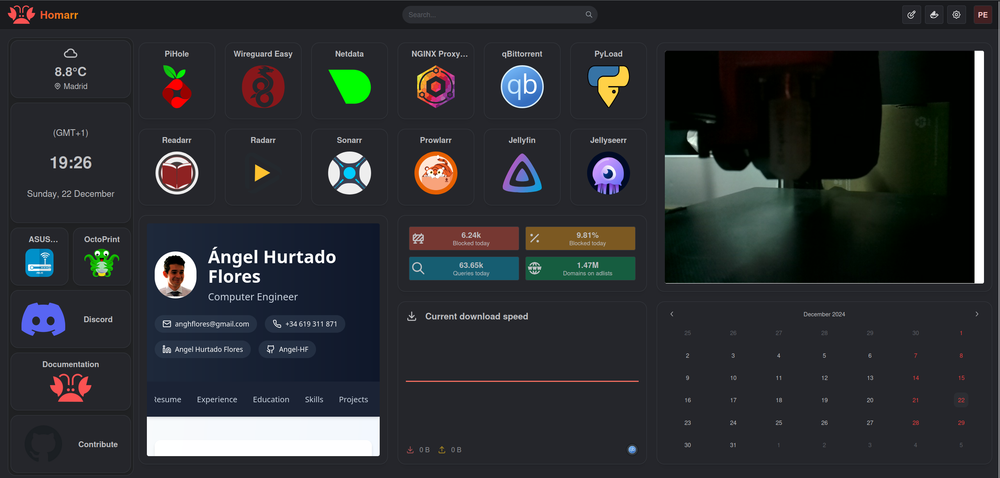
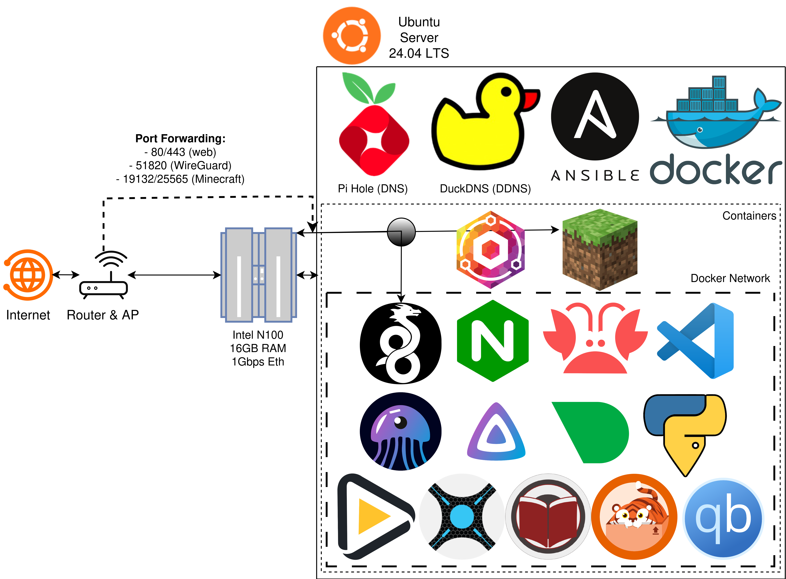

# pelochus/homelab V3
Personal home server configuration and automation. I use this repo as a reminder of all I did and why I did it in case I want to redo my server from the ground up in the future. This also allows me to skip some steps for future installs since I automated installations, configuration and maintenance. Made it public in case anyone wants to see my personal home server configuration as a point of reference or want to see my skills in homelabbing.

## Short Term TODO:
Adding it here to force myself to do as soon as possible:
- Clean up the [wiki](https://github.com/Pelochus/homelab/wiki): stale service and OS
  references left in the pages (Readarr, Pi-Hole, the fstab mount that unattended-upgrades
  replaced)
- Add AI node info (BC250)
- Consider Ansible split per device type (install what is needed on BC250 node differently from N100)

You can see my Homarr instance here, with all the services I have. On the right, you can see my 3D printer webcam.
In the next diagram you can see my homelab's architecture.

## More info
More info about this repo in the [wiki](https://github.com/Pelochus/homelab/wiki). You can find:
- Hardware used
- OS used and its configuration
- Software installed and deployed
- Backups strategy
- Technical information about Ansible automation and Docker containers used

Conventions for working in this repo (design rules, commit style, what is verifiable
where): `AGENTS.md`.

## Secrets
Secrets live in the gitignored `docker/<stack>/.secrets.env`, read through `env_file`;
node facts live in the tracked `docker/<stack>/.env`. A credential that must survive a
redeploy is tracked as a one-way hash.

- `docker/others/.env`: `CODE_SERVER_HASHED_PASSWORD` — argon2 only, bcrypt rejected,
  `echo -n 'password' | argon2 "$(openssl rand -hex 8)" -e -i`, every `$` doubled
  (compose interpolates `$` in `.env` values)
- `docker/monitoring/.secrets.env`: `SECRET_ENCRYPTION_KEY` — `openssl rand -hex 32`,
  64 hex characters; `TOKEN` and `KEY` — from the Beszel hub: Settings → tokens, and the
  system's SSH public key

## TODO:
- Think of backups automation (Rsync + Bash or Ansible)
- Some CI/CD and GitOps (i.e.: auto deploy webserver on git push)
- Use cloud-init for clusters
- Use k3s
- Reduce Ansible usage for things updating Dockers
- Proxmox as base OS, then put Ubuntu Server/Debian on top (or similar)
- Add more services like Uptime Kuma
