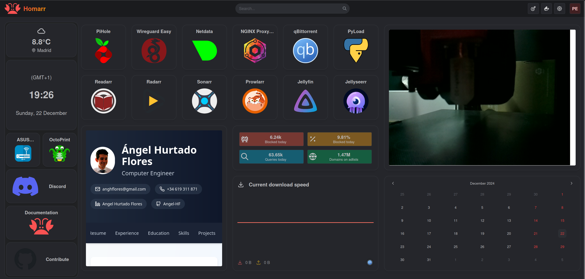
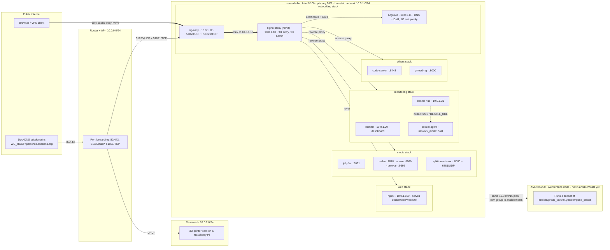

# pelochus/homelab V3

Personal home server: configuration, automation, and the reasoning behind both, so the
whole server can be rebuilt from scratch.

- One node today (`serverbollo`), a cluster later.
- Ansible automates the OS layer and the service deploy.
- One Docker compose stack per service group, reached through a VPN.
- State snapshots live in the repo, secrets do not.

- Homarr dashboard: every service on the left, the 3D-printer webcam on the right.

## Architecture

- Private addressing on `10.0.0.0/16`: router and DHCP `10.0.0.0/24`, this server `10.0.1.0/24`, the printer-cam Pi `10.0.2.0/24`.
- wg-easy is the only public entry point; Nginx Proxy Manager and AdGuard Home answer on the `homelab` Docker network, gateway `10.0.1.1`.
- A container with `network_mode: host` sits outside that network and reaches siblings through a shared volume or the public URL.
- The BC250 node is a plan, not a deploy: it gets its own group in `ansible/hosts` and its own playbook.

## Docs

- [Docs index](docs/README.md) — hardware, OS, software, backups, Ansible, Docker,
  first-time setup
- [Repo conventions](AGENTS.md) — design rules, layout, verification, commit style

## Short-term TODO

- Add the AI node (AMD BC250) to the docs and to `ansible/hosts`.
- Split Ansible per device type: install on the BC250 node what it needs, not what the
  N100 needs.

## TODO

- Rethink backups automation (Rsync + Bash, or Ansible).
- CI/CD and GitOps: auto-deploy the webserver on git push.
- Use cloud-init for clusters.
- Use k3s.
- Reduce Ansible where it only refreshes Docker services.
- Proxmox as base OS, with Ubuntu Server/Debian on top.
- Add more services: Uptime Kuma.
