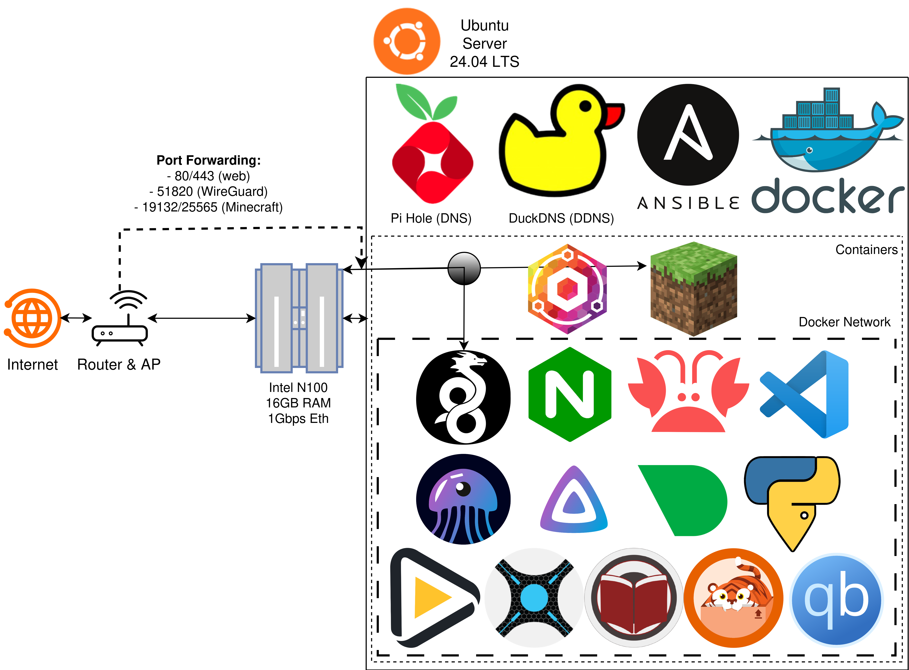

# Homelab docs

The repo code is the source of truth; these pages point at it and state the rules around it.

## Pages

- [Hardware](HARDWARE.md) — the node, its disks, network addressing
- [OS](OS.md) — Ubuntu Server, what the config role owns, maintenance cadence
- [Software](SOFTWARE.md) — services, ports, services not in use
- [Backups](BACKUPS.md) — what state is saved, and the rule behind it
- [Ansible](ANSIBLE.md) — playbooks, roles, `group_vars`, cadence
- [Docker](DOCKER.md) — stacks, files per stack, network, image refresh
- [1st-time-setup](1ST-TIME-SETUP.md) — order of work on a fresh node, the secrets each
  stack needs, guides used

## Repo docs

- [`README.md`](../README.md) — public description and the TODO roadmap
- [`AGENTS.md`](../AGENTS.md) — design rules, layout, verification, commit style
- [`backups/configs/README.md`](../backups/configs/README.md) — state saved on the node

## Architecture

